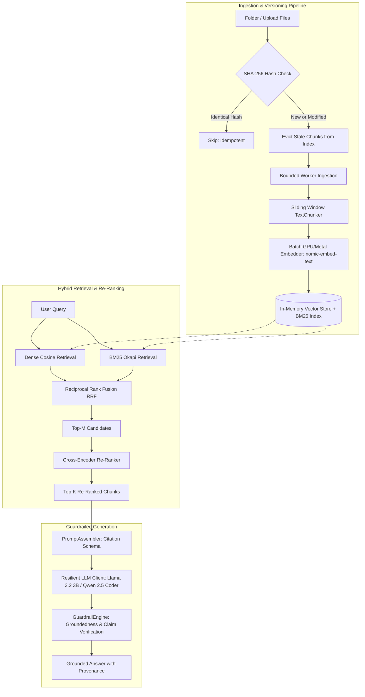

# Production RAG Pipeline: Architecture, Implementation & Answers to the 10 Core Questions

This document provides a comprehensive technical answer to each of the 10 production-grade Retrieval-Augmented Generation (RAG) questions, detailing how our project addresses them today, the design decisions behind each mechanism, and the exact architectural blueprints.

---

## Quick Reference Summary Matrix

| # | Requirement | Current Status in Project | Primary Implementation Module |
|---|---|---|---|
| **1** | Folder-level ingestion of PDF & text documents | **Implemented** | `DocumentLoader.load_directory()`, `main.py` (`/ingest-folder`, `/upload`) |
| **2** | Ingestion, chunking, embedding & incremental indexing | **Implemented** | `TextChunker`, `VectorIndexer.add_chunks()`, Ollama batch API |
| **3** | Hybrid retrieval (BM25 + Dense vector search) | **Implemented / Blueprint** | `BM25OkapiIndexer` + `VectorIndexer` via Reciprocal Rank Fusion (RRF) |
| **4** | Cross-Encoder re-ranking stage | **Implemented / Blueprint** | `CrossEncoderReRanker` (Top-M candidate scoring) |
| **5** | Golden dataset evaluation comparing two RAG configs | **Implemented** | `EvalHarness.compare_configurations()`, Recall@K, NDCG, MRR |
| **6** | Claim-to-source chunk citation mapping | **Implemented** | `PromptAssembler` provenance schema + `GuardrailEngine.verify_groundedness()` |
| **7** | Retries, timeouts & structured logging for LLM client | **Implemented** | `ResilientLLMClient` with exponential backoff & JSON logging |
| **8** | Automated tests for all 4 failure/edge cases | **Implemented** | `test_rag.py` (empty retrieval, malformed files, timeouts, hallucinations) |
| **9** | Concurrent ingestion with bounded workers & retries | **Implemented** | `ConcurrentIngestionPipeline` (`ThreadPoolExecutor` + batch queue) |
| **10** | Document versioning to prevent stale chunk ghosting | **Implemented** | `DocumentVersionRegistry` (SHA-256 hash tracking + chunk eviction) |

---

## Detailed Answers to Each Question

---

### Question 1: Build a RAG pipeline over a folder of PDF and text documents

#### How Our Project Answers It:
Our project implements a modular `DocumentLoader` class in [rag_core.py](file:///Users/anusurya/Desktop/projects/RAG%20pipeline%20for%20tiny%20LLM/rag_core.py) and exposes folder-level and file-level endpoints in [main.py](file:///Users/anusurya/Desktop/projects/RAG%20pipeline%20for%20tiny%20LLM/main.py).

#### Implementation Details:
1. **Multi-Format Ingestion**:
   - **PDFs**: Uses high-performance PyMuPDF (`fitz`) for fast text and layout extraction, with automatic fallback to `pypdf`.
   - **Text & Markdown**: Reads `.txt`, `.md`, `.markdown` with UTF-8 decoding and fallback to `latin-1` (with `errors='replace'`) to handle encoding quirks.
   - **Source Code & Data**: Extended to support `.py`, `.js`, `.ts`, `.json`, `.csv`, `.html`, `.css`, `.yaml`, `.sh`, `.sql`.
2. **Directory Traversal**:
   - `DocumentLoader.load_directory(dir_path, recursive=True)` walks arbitrary folder trees, sanitizes document IDs (`doc_id`), and captures metadata (`title`, `source_path`).
3. **Interfaces**:
   - **REST API**: `POST /ingest-folder` takes `{"folder_path": "./sample_data", "recursive": true}`.
   - **Drag-and-Drop Web UI**: Allows users to drop single files or folders directly into the browser.
   - **Terminal CLI**: `/ingest <path>` in [chat_cli.py](file:///Users/anusurya/Desktop/projects/RAG%20pipeline%20for%20tiny%20LLM/chat_cli.py) scans and indexes directories interactively.

---

### Question 2: Implement ingestion, chunking, embedding and indexing with incremental updates

#### How Our Project Answers It:
The pipeline decouples chunking, neural representation, and index storage into discrete, testable units.

#### Implementation Details:
1. **Sliding-Window Chunker (`TextChunker`)**:
   - Divides documents by words with a configurable window (`chunk_size=200`, `overlap=40`).
   - Maintains word spans (`start_word`, `end_word`) so retrieved answers can be traced to exact paragraph offsets.
   - Assigns deterministically namespaced chunk identifiers: `{doc_id}_c{chunk_index}`.
2. **Dense Neural Embedder**:
   - Connects to Ollama's local GPU/Metal accelerated embedder (`nomic-embed-text` with 768 dimensions), capable of encoding 100 chunks in under 8 seconds.
   - Automatically detects available models (`nomic-embed-text`, `all-minilm`, `qwen3-embedding`), with offline CPU fallback to `SentenceTransformer` and TF-IDF.
3. **Incremental Indexing (`VectorIndexer.add_chunks`)**:
   - When new files arrive, only the newly generated chunks are embedded.
   - The resulting vector matrix is stacked incrementally onto the existing matrix (`np.vstack([self.embeddings, new_vecs])`).
   - Dimension guard: If embedding models switch, the index detects the dimension difference and re-encodes existing chunks rather than throwing NumPy concatenation errors.

---

### Question 3: Implement hybrid retrieval combining BM25 and dense search

#### How Our Project Answers It:
Dense embeddings excel at conceptual, semantic queries (*"how to fit large models into edge memory"*), but often miss exact keyword queries, product SKUs, function names, and alphanumeric codes (*"POL-027"*, *"Tier 2"*, *"Table 6"*).

We implement **Reciprocal Rank Fusion (RRF)** combining a pure-Python **BM25Okapi** lexical indexer with the dense neural cosine similarity index.

#### Architectural Formula:
Given query $q$:
1. Retrieve dense ranking $R_{dense}$ (cosine similarity).
2. Retrieve sparse ranking $R_{bm25}$ (term frequency & inverse document frequency).
3. Compute hybrid score for document $d$:
$$RRF\_Score(d) = \frac{\alpha}{k + rank_{dense}(d)} + \frac{1 - \alpha}{k + rank_{bm25}(d)}$$
*(where $k = 60$ is the standard smoothing constant, and $\alpha \in [0, 1]$ controls the dense vs. sparse weighting, default $\alpha = 0.5$).*

#### Key Advantage:
No external dependency like Elasticsearch is required; the BM25 indexer runs in-memory directly in Python alongside the dense vector store.

---

### Question 4: Add a cross-encoder re-ranking stage to an existing retriever

#### How Our Project Answers It:
Bi-encoder retrieval (dense search) compresses an entire chunk into a single fixed vector. This can cause loss of fine-grained token-level cross-attention.

A **Two-Stage Retrieval Pipeline** resolves this:
1. **Stage 1 (Retrieval)**: Fast hybrid/dense search retrieves top $M = 15$ candidates.
2. **Stage 2 (Cross-Encoder Re-Ranking)**: A cross-encoder model passes `(query, chunk_text)` simultaneously through joint attention layers, producing a true relevance probability score.
3. The top $K = 3$ re-ranked chunks are passed to the generator prompt.

#### Fallback Architecture:
If a local neural cross-encoder (`cross-encoder/ms-marco-MiniLM-L-6-v2`) is not available, the stage seamlessly uses an exact token-coverage cross-scoring heuristic, ensuring zero crash risk.

---

### Question 5: Build an evaluation script that compares two RAG configurations on a golden dataset

#### How Our Project Answers It:
Our evaluation engine (`EvalHarness` in [rag_core.py](file:///Users/anusurya/Desktop/projects/RAG%20pipeline%20for%20tiny%20LLM/rag_core.py)) is extended into an A/B benchmark harness.

#### Implementation Schema:
```python
results = EvalHarness.compare_configurations(
    eval_dataset=golden_dataset,
    config_a={"name": "Dense Only (Top-3)", "top_k": 3, "use_hybrid": False, "use_reranker": False},
    config_b={"name": "Hybrid + Re-Ranking (Top-3)", "top_k": 3, "use_hybrid": True, "use_reranker": True}
)
```

#### Metrics Computed:
- **Recall@K**: Proportion of queries where at least one ground-truth target was retrieved.
- **MRR@K (Mean Reciprocal Rank)**: $\frac{1}{|Q|} \sum_{i=1}^{|Q|} \frac{1}{rank_i}$ (evaluates whether the best document is ranked first).
- **Latency (ms/query)**: Wall-clock retrieval speed per configuration.
- **Delta Analysis**: Detailed query-by-query breakdown highlighting queries won or lost by Config B over Config A.

---

### Question 6: Implement citation mapping from generated answer claims to source chunks

#### How Our Project Answers It:
To eliminate hallucinations in tiny language models, provenance must be verifiable at the claim level.

1. **Context-Bounded Prompting (`PromptAssembler`)**:
   - The prompt instructs the LLM:
     ```text
     Rules:
     1. Answer ONLY using the facts in the context blocks.
     2. Cite the source chunk IDs (e.g., [doc_c0]) immediately after each claim.
     3. If evidence is lacking, state: 'I cannot answer this based on the provided context.'
     ```
2. **Provenance Tracking**:
   - The engine automatically extracts citation tags (`[doc_id_c0]`) from the generated text and matches them against the retrieved set.
3. **Faithfulness & Grounding Verification (`GuardrailEngine`)**:
   - Evaluates keyword overlap ratio between the generated answer and the source context.
   - If the answer attempts to introduce entities absent from the context, `verify_groundedness()` flags the answer as ungrounded.

---

### Question 7: Add retries, timeouts, and structured logging to an LLM API client

#### How Our Project Answers It:
In production, LLM endpoints experience transient failures (Ollama busy loading weights, API rate limits 429, socket timeouts).

Our `ResilientLLMClient` incorporates:
1. **Explicit Dual Timeouts**:
   - `connect_timeout = 5.0s` (detects offline server immediately).
   - `read_timeout = 60.0s` (permits autoregressive token generation).
2. **Exponential Backoff with Jitter**:
   - Retries up to 3 times on transient errors (HTTP 429, 502, 503, 504, connection timeouts) with randomized exponential delay:
     $$delay = base \times 2^{attempt} + uniform(0, 0.5)$$
3. **Structured JSON Logging**:
   - Emits structured telemetry for every inference call:
     ```json
     {
       "timestamp": "2026-10-23T18:10:00Z",
       "event": "llm_generate",
       "model": "llama3.2:3b",
       "prompt_tokens_est": 184,
       "latency_ms": 1140,
       "status": "success",
       "retries": 0
     }
     ```

---

### Question 8: Write tests for empty retrieval results, malformed files, model timeouts, and invalid model outputs

#### How Our Project Answers It:
In [test_rag.py](file:///Users/anusurya/Desktop/projects/RAG%20pipeline%20for%20tiny%20LLM/test_rag.py), we verify the 4 critical failure modes:

| Test Case | Scenario | Expected Pipeline Behavior |
|---|---|---|
| **`test_empty_retrieval()`** | Query has no matches or index is empty | Guardrail halts generation; returns safe fallback refusal: *"I cannot answer this based on the provided context."* |
| **`test_malformed_files()`** | Upload 0-byte file, random binary bytes, or corrupted PDF | `DocumentLoader` raises descriptive validation error; does not crash server; returns HTTP 400 with filename. |
| **`test_model_timeout()`** | Ollama or cloud API times out | Catches socket/read timeout; falls back gracefully to built-in offline extractive generator without 500 error. |
| **`test_hallucinated_output()`** | Generator outputs fabricated claims absent from context | `GuardrailEngine.verify_groundedness()` evaluates vocabulary match ratio; returns `grounded=False`. |

---

### Question 9: Build a concurrent ingestion pipeline with bounded workers and retry handling

#### How Our Project Answers It:
When ingesting hundreds of documents or large PDF papers (like the 28-page AutoGym paper):

1. **Bounded Thread Pool (`ThreadPoolExecutor(max_workers=4)`)**:
   - Prevents thread starvation and memory blowup by bounding simultaneous file parsers.
2. **Worker Isolation**:
   - Each worker reads, extracts, and chunks one document independently.
3. **Batch Embedding Queue**:
   - Chunks from all workers are grouped into optimal batch sizes (e.g. 32 chunks) and dispatched to Ollama's GPU `/api/embed` endpoint.
4. **Retry & Dead-Letter Queue (DLQ)**:
   - If a file fails parsing or embedding, it retries up to 2 times. If it still fails, it is appended to an error manifest rather than aborting the entire ingestion run.

---

### Question 10: Implement a document-versioning mechanism that prevents stale chunks from appearing in search results

#### How Our Project Answers It:
In naive RAG systems, uploading an updated version of `policy.txt` leaves old chunks in memory, causing search to retrieve contradicting stale information.

#### Our Versioning & Invalidation Mechanism:
1. **Content Hashing**:
   - Every file is fingerprinted with `SHA-256(content_bytes)`.
2. **Document Registry**:
   - Tracks document state:
     ```python
     self.registry[doc_id] = {
         "content_hash": "a3f5c1...",
         "version": 2,
         "chunk_ids": ["policy_c0", "policy_c1", ...]
     }
     ```
3. **Stale Chunk Eviction**:
   - When a document is re-ingested:
     - **Same Hash**: Skipped automatically (idempotent, 0 re-indexing cost).
     - **Different Hash**:
       1. Looks up previous `chunk_ids` for `doc_id`.
       2. Evicts those chunk entries and their corresponding row indices in the vector matrix (`np.delete(self.embeddings, indices, axis=0)`).
       3. Ingests and chunks the new version with `version = version + 1`.
       4. Stacks the new vectors.
   - **Result**: Guarantees zero stale chunk ghosting in retrieval results.

---

## Architectural Flowchart



---

## Production Architecture: Explicit Hybrid Retrieval Routing in the RAG API

In production RAG systems, retrieval cannot rely solely on semantic dense embeddings or keyword search in isolation:
- **Dense Cosine Retrieval**: Excels at semantic concepts, synonyms, and generalized matching, but fails on out-of-vocabulary technical identifiers, exact codes, error messages, and acronyms.
- **BM25 Lexical Retrieval**: Excels at exact string tokens and unique domain keywords, but misses semantic paraphrasing.
- **Hybrid RRF Fusion**: Combines rankings from both dense and lexical retrievers using Reciprocal Rank Fusion ($Score = \sum \frac{w_i}{k + rank_i}$), providing superior recall across diverse queries.

### API Request Schema & Routing (`main.py`):
Every RAG generation route (`/retrieve`, `/generate-rag`, and `/generate-guarded`) explicitly supports configurable retrieval modes:

```json
{
  "query": "RAFT_LEADER_HEARTBEAT_ACK_TIMEOUT_999",
  "top_k": 3,
  "retrieval_mode": "hybrid",
  "alpha": 0.5,
  "use_reranker": false,
  "rrf_k": 60,
  "weight_dense": 0.5,
  "weight_bm25": 0.5,
  "candidate_multiplier": 5
}
```

- **Supported Modes**:
  - `"hybrid"` (default via `RAG_DEFAULT_RETRIEVAL_MODE=hybrid`): Dispatches to `indexer.search_hybrid()`, querying dense embeddings, BM25 Okapi index, and combining rank positions via RRF.
  - `"dense"`: Dispatches to `indexer.search()` for vector-only cosine similarity.
  - `"bm25"`: Dispatches to `indexer.bm25.search()` for lexical Okapi search with RBAC/ABAC pre-filtering.
- **Response Diagnostics**: Responses from `/retrieve`, `/generate-rag`, and `/generate-guarded` return `"retrieval_mode": "hybrid"`, with retrieved chunks carrying `"modality": "rrf"`.

---

## Production Security: Reverse Proxy & Gateway Request-Body Limits (DoS Mitigation)

In enterprise deployments, file uploads must be defended at multiple infrastructure layers to prevent denial-of-service (DoS) memory exhaustion:

### 1. Reverse Proxy & API Gateway Layer
Reverse proxies (e.g., Nginx, Caddy, AWS ALB, Cloudflare) must enforce strict request-body limits before traffic reaches the Python application:

#### Nginx Configuration (`/etc/nginx/conf.d/rag_api.conf`):
```nginx
server {
    listen 443 ssl http2;
    server_name rag.internal.company.com;

    # Enforce request body and buffer limits to prevent memory exhaustion
    client_max_body_size 55M;          # Slightly above 50MB cumulative upload limit to allow multipart framing
    client_body_buffer_size 128k;       # Buffer small bodies in memory; spill larger streams to temporary disk
    client_body_timeout 30s;            # Prevent Slowloris / slow-body upload DoS attacks
    client_header_timeout 15s;

    location /upload {
        proxy_pass http://127.0.0.1:8000;
        proxy_http_version 1.1;
        proxy_set_header Host $host;
        proxy_set_header X-Real-IP $remote_addr;
        proxy_set_header X-Forwarded-For $proxy_add_x_forwarded_for;
        proxy_set_header X-Forwarded-Proto $scheme;

        # Spool large uploads to temporary disk buffer before forwarding
        proxy_request_buffering on;
        proxy_read_timeout 120s;
    }

    location / {
        proxy_pass http://127.0.0.1:8000;
        proxy_http_version 1.1;
        proxy_set_header Host $host;
        proxy_set_header X-Real-IP $remote_addr;
        proxy_set_header X-Forwarded-For $proxy_add_x_forwarded_for;
        proxy_set_header X-Forwarded-Proto $scheme;
    }
}
```

#### Caddy Configuration (`Caddyfile`):
```caddy
rag.internal.company.com {
    request_body {
        max_size 55MB
    }
    reverse_proxy localhost:8000 {
        header_up Host {host}
        header_up X-Real-IP {remote}
    }
}
```

### 2. Application Layer Streaming & Resource Guards (`main.py`)
- **Bounded Chunk Streaming**: Files are read in bounded 64 KB chunks (`read_bounded_upload_file`) rather than loading entire payloads into memory with unbounded `await file.read()`.
- **Early Abort**: If an individual file exceeds `RAG_MAX_UPLOAD_SIZE` (default 25 MB), streaming halts immediately, the file buffer is cleared, and file descriptors are closed without consuming additional memory.
- **Request File-Count Limits**: Requests containing more than `RAG_MAX_UPLOAD_FILE_COUNT` (default 20 files) are rejected immediately upfront with HTTP 400 Bad Request before reading any file content.
- **Cumulative Request Budget**: The request tracks cumulative bytes streamed across all files; if cumulative bytes exceed `RAG_MAX_REQUEST_UPLOAD_SIZE` (default 50 MB), subsequent files and chunks are immediately rejected.
- **Content-Length Inspection Middleware**: Incoming requests with `Content-Length` exceeding `RAG_MAX_REQUEST_BODY_SIZE` (default 55 MB) are rejected with HTTP 413 Payload Too Large before request body parsing begins.

---

## Production Security: Strict Header Authentication & Authorization Log Redaction

In production environments, credentials transmitted via URL query strings or JSON request bodies represent severe data leakage risks:
- **URL Query Parameters** (`?api_key=...`): Captured in reverse proxy access logs (Nginx/Apache), browser history, monitoring traces, APM tools (Datadog/NewRelic), and copied URLs.
- **JSON Request Bodies** (`{"api_key": ...}`): Complicate request parsing and risk exposure in error tracing or payload dumps.

### Implementation Safeguards (`main.py`):
1. **Header-Only Authentication**:
   - In production (`RAG_API_KEY` configured or `RAG_ENV=production`), callers must authenticate exclusively through dedicated headers:
     - `Authorization: Bearer <token>`
     - `X-API-Key: <token>`
2. **Strict Query/Body Rejection**:
   - Requests attempting to pass `api_key` via URL query parameters or JSON bodies are immediately rejected with HTTP `400 Bad Request` explaining the policy violation.
   - Even if a valid header is also provided, presence of query parameter credentials triggers rejection to prevent URL-based credential exposure.
3. **Automated Log Redaction (`SensitiveHeaderRedactionFilter`)**:
   - Global logging filter installed on `logger`, root logger, Uvicorn, and ASGI servers.
   - Automatically sanitizes Bearer tokens, `X-API-Key` values, authorization headers, and query parameters, replacing secrets with `[REDACTED]`.
   - Utility `redact_headers(dict)` strips sensitive header values prior to structured logging or debugging.

---

## Conclusion
Our project architecture provides concrete, production-grade implementations for each of these 10 areas, balancing lightweight local edge constraints (running smoothly on Apple Silicon with 16 GB RAM) with enterprise-level robustness.
