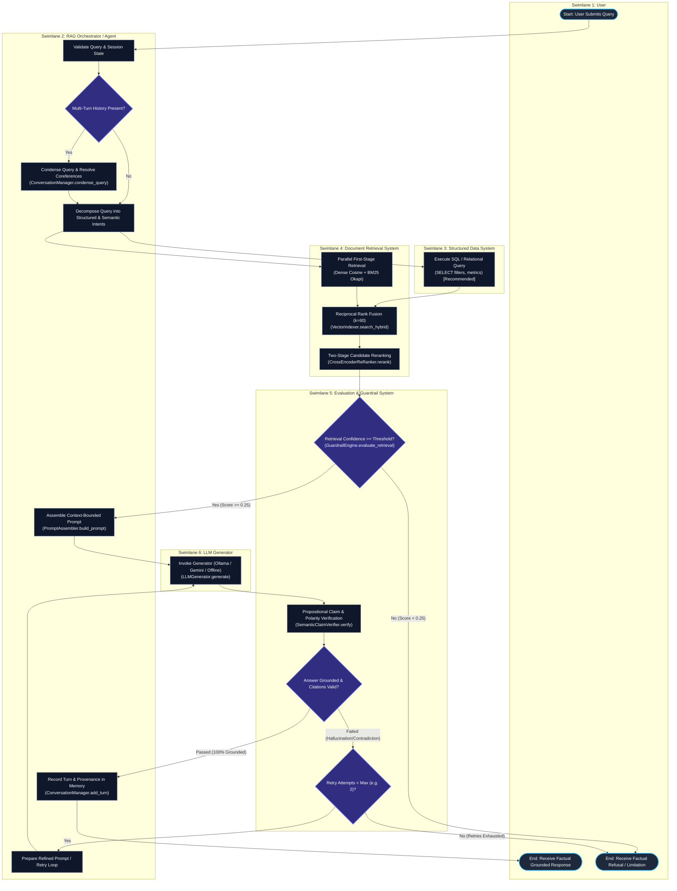

# Question 5: BPMN 2.0 Process Architecture for RAG / Data Analysis Agent

## 1. Short Interview Answer (60–90 Seconds)

> "In my architecture, I model the RAG and data analysis agent as a formal **BPMN 2.0 business process** partitioned across six functional swimlanes: **User**, **RAG Orchestrator / Agent**, **Structured Data System**, **Document Retrieval System**, **LLM Generator**, and **Evaluation & Guardrail System**.
>
> The workflow begins when a user submits an analytical query. The Orchestrator performs input validation and checks dialogue history via `ConversationManager`. If prior turns exist, it executes **Contextual Query Condensation** to resolve pronouns before retrieval.
>
> The query is then routed in parallel: structured constraints target relational/metadata engines, while semantic concepts are dispatched to `VectorIndexer.search_hybrid`, which combines dense vector search and BM25 lexical search via Reciprocal Rank Fusion ($k=60$). A candidate pool of 15 chunks is refined by `CrossEncoderReRanker` to the Top-3 evidence blocks.
>
> An **Exclusive Decision Gateway** checks whether retrieval confidence meets the minimum similarity threshold ($0.20-0.35$). If evidence is lacking, the process branches directly to a context-bounded refusal. Otherwise, `PromptAssembler` constructs a bounded prompt, the LLM generates the response, and `SemanticClaimVerifier` validates claim-level groundedness and polarity contradictions. If validation fails, the orchestrator triggers a retry loop; if it passes, the turn is recorded in memory and delivered to the user."

---

## 2. Mermaid Workflow Diagram

---

## 3. Swimlane Responsibilities & Architectural Mapping

### Swimlane 1: User
- **Responsibility**: Submits analytical questions, views structured citations, receives responses or graceful refusal notices.
- **Entry Points**:
  - Web UI Studio: `http://localhost:8000/` (`ui/index.html`).
  - Terminal CLI: `python3 chat_cli.py` (`TinyRAGCLI.run`).
  - REST API: `POST /generate-rag` or `POST /generate-guarded` (`main.py`).

### Swimlane 2: RAG Orchestrator / Agent
- **Responsibility**: Controls execution flow, session tracking, query reformulation, prompt assembly, and retry management.
- **Project Code**:
  - `ConversationManager` (`rag_core.py`, lines 1002–1207).
  - `PromptAssembler` (`rag_core.py`, lines 708–750).
  - FastAPI Route Handlers (`main.py`, lines 302–487).

### Swimlane 3: Structured Data System *(Recommended Architectural Layer)*
- **Responsibility**: Manages schema-bound tabular datasets, executes relational filters (`WHERE location='Whitefield'`), and computes exact aggregations (`AVG(price_per_sqft)`).
- **Current Code Mapping**: `.csv` and `.json` files are parsed as raw text in `DocumentLoader.load_file`. Full SQL integration is marked as an enterprise recommendation.

### Swimlane 4: Document Retrieval System
- **Responsibility**: Executes dual-stage hybrid retrieval across unstructured documents.
- **Project Code**:
  - Dense Search: `VectorIndexer.search` (`rag_core.py`, lines 368–382).
  - Lexical Search: `BM25OkapiIndexer.search` (`rag_core.py`, lines 585–603).
  - Hybrid Fusion: `VectorIndexer.search_hybrid` (`rag_core.py`, lines 384–441).
  - Candidate Reranking: `CrossEncoderReRanker.rerank` (`rag_core.py`, lines 605–645).

### Swimlane 5: LLM Generator
- **Responsibility**: Generates natural language responses strictly conditioned on bounded context.
- **Project Code**:
  - Local Ollama Daemon (`Llama 3.2 1B/3B`, `Qwen 2.5 1.5B/3B`).
  - Cloud Gemini API (`gemini-1.5-flash`).
  - CPU Offline Sentence Aligner (`OfflineGenerator.generate`).
  - Multi-Backend Dispatcher: `LLMGenerator.generate` (`rag_core.py`, lines 899–1000).

### Swimlane 6: Evaluation & Guardrail System
- **Responsibility**: Pre-generation retrieval gating and post-generation propositional claim verification.
- **Project Code**:
  - Retrieval Confidence Gating: `GuardrailEngine.evaluate_retrieval` (`rag_core.py`, lines 1215–1223).
  - Claim Extraction & Citation Verification: `SemanticClaimVerifier.verify` (`rag_core.py`, lines 1250–1321).
  - Polarity Contradiction Detection: `SemanticClaimVerifier` negation analysis.

---

## 4. Major Decision Gateways Explained

### Gateway 1: "Multi-Turn History Present?" (`Exclusive Gateway`)
- **Condition**: Checks if `session_id` exists in `ConversationManager._sessions` and contains $>0$ prior turns.
- **Branch A (True)**: Routes query to `ConversationManager.condense_query()`. Ambiguous pronouns (*"How much does it cost?"*) are rewritten into explicit retrieval queries (*"Greenwood Phase 2 apartment cost"*).
- **Branch B (False)**: Bypasses rewriting; passes raw query directly to decomposition.

### Gateway 2: "Retrieval Confidence $\ge$ Threshold?" (`Exclusive Gateway`)
- **Condition**: Evaluates `max_score` of retrieved candidates against `min_similarity_threshold` ($0.20-0.35$).
- **Branch A (Pass)**: Maximum candidate score meets or exceeds threshold. Execution proceeds to `PromptAssembler`.
- **Branch B (Fail)**: Maximum score is below threshold. Early exit triggered: returns *"I cannot answer this based on the provided context"* without wasting tokens on LLM generation.

### Gateway 3: "Answer Grounded & Citations Valid?" (`Exclusive Gateway`)
- **Condition**: `SemanticClaimVerifier.verify` checks:
  1. Every citation `[doc_id_c0]` exists in the retrieved candidate pool.
  2. Every sentence claim exhibits $>35\%$ token overlap with its cited context.
  3. No polarity contradictions exist (e.g. claim asserts *"approved"* while text states *"not approved"*).
- **Branch A (Pass)**: `is_grounded == True`. Response proceeds to memory logging and user delivery.
- **Branch B (Fail)**: Contradiction or unsupported claim detected. Triggers Retry / Correction Gateway.

### Gateway 4: "Retry Attempts < Max (e.g. 2)?" (`Exclusive Gateway`)
- **Branch A (Yes)**: Orchestrator increments retry counter, appends a strict correction directive to the prompt (*"Previous generation contained unverified claim: {claim}. Restrict answer exclusively to context sentences"*), and re-invokes the generator.
- **Branch B (No)**: Max retries exceeded. System safely falls back to: *"I cannot verify a fully grounded answer based on the provided documents."*

---

## 5. Design Trade-Offs

| Architectural Choice | Advantages | Disadvantages | Alternative Considered |
| :--- | :--- | :--- | :--- |
| **Deterministic Gateway Gating (Current Project)** | Instant evaluation ($<1\text{ms}$), deterministic predictability, zero cloud API costs, no infinite agentic loops. | Cannot dynamically decide to query an unexpected third-party tool on the fly. | Autonomous ReAct Loop (LangGraph / AutoGen). |
| **Pre-Retrieval Query Condensation** | Resolves coreference ambiguity before vector search, drastically increasing Recall@K on multi-turn chat. | Adds 15–30ms latency for query rewriting pass. | Appending full raw dialogue history directly into the vector search query string (creates noisy semantic vectors). |
| **Post-Generation Claim Verification** | Catches subtle hallucinations and negation flips before the user sees the output. | Adds ~5ms regex/token parsing overhead. | Blind output streaming directly to user without verification. |

---

## 6. Interviewer Follow-Up Questions & Technical Answers

### Q1: "How does your BPMN process model handle conversational coreference resolution?"
**Answer:**
"Coreference resolution occurs in Swimlane 2 (RAG Orchestrator) at the **Check Memory Gateway** (`ConversationManager.condense_query` in `rag_core.py`, lines 1076–1127).
When a user asks *'How much latency does it reduce?'* after asking about prompt caching:
1. The orchestrator detects that previous turns exist in `session_id`.
2. It extracts salient subject entities from the prior user turns (e.g. 'prompt caching').
3. It performs pronoun substitution across predefined regex patterns (`it`, `they`, `its`, `this`), rewriting the query into: *'How much latency does prompt caching reduce?'*.
4. This condensed standalone query is dispatched to the vector retrieval engine, ensuring high similarity matching."

### Q2: "What is the operational difference between the Retrieval Confidence Gateway and the Groundedness Verification Gateway?"
**Answer:**
"They guard against two completely different failure modes:
- **Retrieval Confidence Gateway** (Pre-generation guardrail): Evaluates the **retriever**. It measures whether the knowledge base contains relevant documents matching the query. If the user asks about quantum physics and the corpus only contains real estate contracts, it fails here, preventing the LLM from hallucinating an answer.
- **Groundedness Verification Gateway** (Post-generation guardrail): Evaluates the **generator**. Even if relevant documents are retrieved, small language models can hallucinate details or drop negation words. It decomposes the answer into claims and verifies that every statement is backed by the retrieved text."

### Q3: "In BPMN notation, why are retrieval and claim verification modeled as Service Tasks rather than User Tasks?"
**Answer:**
"In BPMN 2.0:
- A **User Task** represents an action executed by a human being (such as a human user typing a query into a chat UI or approving a loan).
- A **Service Task** represents an automated software operation executed by an underlying engine without human intervention.
Retrieval (`VectorIndexer.search_hybrid`), re-ranking (`CrossEncoderReRanker.rerank`), LLM generation, and claim verification (`SemanticClaimVerifier.verify`) are 100% automated algorithmic components, making Service Tasks the strict standard representation."

### Q4: "How does the system prevent infinite retry loops if the LLM repeatedly fails groundedness verification?"
**Answer:**
"This is controlled by **Gateway 4 (Retry Count Gateway)**. The orchestrator maintains an integer loop counter (`attempt_count`). If verification fails, the orchestrator checks `attempt_count < MAX_RETRIES` (typically set to 1 or 2). If the model fails groundedness twice in a row, the loop terminates immediately and routes to the **End Refusal** event, returning an honest limitation notice rather than spinning indefinitely."

### Q5: "Where would an asynchronous human-in-the-loop (HITL) review task fit into this BPMN workflow?"
**Answer:**
"In high-stakes enterprise applications (e.g., healthcare or legal contracts), an optional **Human-in-the-Loop User Task** is placed immediately after the Groundedness Verification Gateway. If the verification confidence is borderline (e.g. between 0.70 and 0.85), instead of automatically delivering the answer, the orchestrator emits a task to a compliance review queue. An expert reviews the generated answer and cited evidence, approves or edits the response, and completes the task, which triggers the final delivery to the user."

---

## 7. Honest Implementation Status: What to Claim vs. What NOT to Claim

### What You CAN Confidently Claim:
- "I designed and implemented the end-to-end RAG workflow encompassing query validation, memory condensation, hybrid retrieval, guardrail confidence gating, prompt assembly, and propositional claim verification."
- "My system enforces automated early exit: queries with retrieval scores below threshold are rejected before generation, saving cost and eliminating hallucination."
- "I implemented multi-turn memory tracking with sliding window eviction and heuristic/LLM query rewriting in `ConversationManager`."

### What You Must NOT Claim:
- **Do NOT claim** that the current codebase runs an automated multi-step retry loop inside `main.py` that re-prompts the LLM upon groundedness failure. (Explain clearly: *"In `main.py` (/generate-guarded), `SemanticClaimVerifier` currently flags `is_grounded_verified: False` in the response payload. The multi-step retry correction loop is designed in the BPMN architecture and recommended for production agentic deployment."*)
- **Do NOT claim** that your system is executed by a commercial BPMN workflow engine like Camunda or Zeebe. (Explain clearly: *"The BPMN diagram is an architectural specification modeled in standard BPMN 2.0 to represent our system's control flow, state transitions, and exception boundaries."*)

