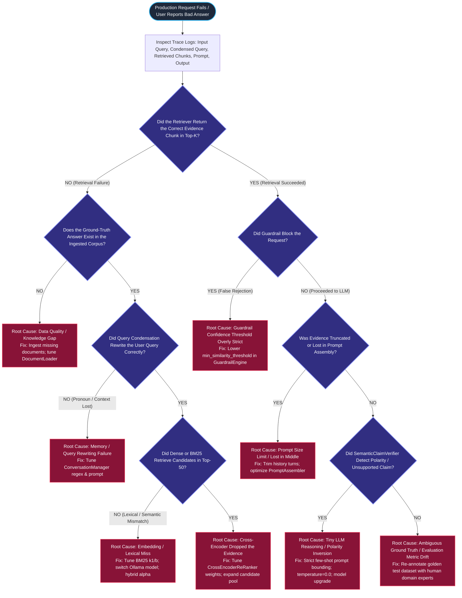

# Production AI Engineering: Scenarios, Debugging & Optimization

This guide provides deep, project-specific solutions for senior production scenarios based on the actual codebase implementation of the **Production-Grade Offline RAG Pipeline**.

---

# Scenario 1: Model Works in Offline Testing but Fails on Real User Queries

## 1. Problem Diagnosis & Fundamental Causes

The divergence between offline test success and production failure in RAG systems is almost never a random anomaly; it is driven by **distribution shift**, **unrealistic evaluation data**, or **untracked pipeline drift**.

```
┌──────────────────────────────────────────────┐       ┌──────────────────────────────────────────────┐
│             OFFLINE TEST SUITE               │       │             PRODUCTION TRAFFIC               │
├──────────────────────────────────────────────┤       ├──────────────────────────────────────────────┤
│ • Synthetically drafted, complete queries    │  VS   │ • Ambiguous, truncated, elliptical inputs   │
│ • Single-turn questions ("What is X?")       │       │ • Multi-turn pronouns ("How much does it...")│
│ • Curated, clean markdown/text files         │       │ • Complex PDF tables, scans, missing data    │
│ • Lexical alignment with document text       │       │ • Jargon, typos, colloquial phrasing         │
│ • High confidence matches (score > 0.60)     │       │ • Out-of-distribution queries (score < 0.25) │
└──────────────────────────────────────────────┘       └──────────────────────────────────────────────┘
```

### 1.1 Five Diagnostic Dimensions
1. **Distribution Shift (Query Space)**: In `test_rag.py`, unit test queries like *"What is quantization for tiny models?"* directly reuse words found in `sample_data/quantization_primer.md`. Production users type: *"Can I run it on 4GB RAM without killing battery?"*
2. **Contextual & Conversational Memory Failures**: Production users speak in multi-turn dialogues. Without robust coreference resolution, a follow-up query like *"How much latency does it cut?"* fails retrieval because the standalone term *"prompt caching"* is missing from the query string.
3. **Data Quality & Parsing Degradation**: Production PDFs contain complex column layouts, headers, footers, and scanned text. PyMuPDF or pypdf might extract text in scrambled reading order, separating related table columns.
4. **Model & Prompt Drift**: Offline tests often run with deterministic zero temperature or mock generators (`OfflineGenerator`), whereas production traffic hits local Ollama daemons (`llama3.2:1b`) with non-zero temperature, leading to instruction non-compliance.
5. **Evaluation Dataset Leakage**: Test datasets created by the same engineers who wrote the chunker inadvertently use identical chunk sizes and vocabulary, creating an artificial 95% Recall@K that collapses in production.

---

## 2. Production Diagnostic Decision Tree



---

## 3. Investigating in the Actual Codebase

### Step 1: Production Query Sampling & Categorization
In `main.py`, configure an interceptor middleware to log all requests, condensed queries, retrieved chunk IDs, guardrail decisions, and answers into a structured JSONL audit stream:
```python
# main.py logging structure
audit_record = {
    "timestamp": time.time(),
    "session_id": req.session_id,
    "raw_query": req.query,
    "standalone_query": standalone_query,
    "retrieved_chunk_ids": [c["chunk_id"] for c in retrieved],
    "max_similarity_score": max([c.get("score", 0.0) for c in retrieved]) if retrieved else 0.0,
    "guardrail_status": passed,
    "output_answer": output["answer"],
    "verifier_grounded": is_grounded
}
```
Classify sampled failures into four buckets:
- **Bucket 1: Out-of-Domain (OOD)** (User asks questions completely absent from indexed docs).
- **Bucket 2: Retrieval Miss** (Document exists, but score was below threshold or ranked $>K$).
- **Bucket 3: Context Distraction** (Right document retrieved, but LLM extracted wrong sentence).
- **Bucket 4: Polarity Inversion** (LLM generated *"approved"* instead of *"not approved"*).

### Step 2: Isolating the Failure Stage via Golden Context Injection
To determine whether the failure is in **Retrieval** or **Generation**, run an A/B ablation test on the failed query:
1. Manually identify the exact ground-truth chunk for the query.
2. Bypass `VectorIndexer.search` and feed the ground-truth chunk directly into `PromptAssembler.build_prompt()`.
3. Pass the resulting prompt to `LLMGenerator.generate()`.
   - **If the model now answers correctly**: The generator is completely fine. The root cause is 100% upstream (Chunking, Embedding, or Reranking).
   - **If the model STILL fails or hallucinates**: The problem is downstream in Prompt Assembly (bad system instructions) or Model Capacity (1B parameter model cannot follow the reasoning).

### Step 3: Inspecting via Tracing (LangSmith / Arize Phoenix / OpenInference)
Integrate OpenTelemetry instrumentation around `rag_core.py` functions:
```python
# OpenTelemetry / LangSmith Tracing Instrumentation
from langsmith import traceable

@traceable(run_type="retriever", name="hybrid_retriever")
def traced_search(query: str, top_k: int = 3):
    return indexer.search_hybrid(query, top_k=top_k, use_reranker=True)

@traceable(run_type="llm", name="tiny_llm_generator")
def traced_generate(prompt: str, retrieved_chunks: list, query: str):
    return LLMGenerator.generate(prompt, retrieved_chunks, query)
```
In the trace viewer:
- Check the exact **query string** passed from `ConversationManager.condense_query` into the retriever.
- Inspect the **chunk contents** and verify whether the answer was cut across chunk boundaries.
- Inspect the **raw LLM prompt** to ensure prompt tokens did not exceed the tiny model's attention budget.

---

# Scenario 2: RAG System Generates Inaccurate / Hallucinated Answers

## 1. Step-by-Step RAG Debugging Protocol

When a RAG system produces incorrect answers, debugging must follow a disciplined, isolated component elimination workflow rather than guessing or modifying prompts arbitrarily.

```
+──────────────────────────────────────────────────────────────────────────────────────────────────+
|                               STAGE-BY-STAGE ISOLATION PROTOCOL                                  |
|                                                                                                  |
| [Stage 1: Document Parsing]  ──> Did DocumentLoader extract all text without mangling tables?    |
| [Stage 2: Chunk Integrity]   ──> Does ANY individual chunk contain the complete answer fact?     |
| [Stage 3: Embedding Recall]  ──> Is the target chunk present in the Top-50 candidate pool?       |
| [Stage 4: BM25 / RRF Fusion] ──> Did exact keywords receive proper weighting in RRF score?       |
| [Stage 5: Reranker Fidelity] ──> Did CrossEncoderReRanker elevate or demote the target chunk?    |
| [Stage 6: Prompt Assembly]   ──> Did chunk ID and text appear within the model's context budget? |
| [Stage 7: Generator Output]  ──> Did tiny LLM accurately reason and cite without negation flip?  |
+──────────────────────────────────────────────────────────────────────────────────────────────────+
```

---

## 2. Failure Modes, Code Symptoms & Exact Codebase Fixes

### 2.1 Chunking & Boundary Slicing Failures
- **Symptom**: The user asks for a price condition, but the model replies *"Information not provided"*, even though the PDF contains the price.
- **Investigation in Code**:
  Inspect `TextChunker.chunk_document` in `rag_core.py` (lines 186–224). Because chunking splits on raw word counts (`chunk_size=150, overlap=30`), a condition like *"The lease fee is \$12,000 per annum [boundary] payable in four quarterly installments"* gets sliced across chunks. Chunk 1 has the fee without installment terms; Chunk 2 has installment terms without the fee.
- **Code Fix**:
  Implement sentence-aware or semantic paragraph splitting:
  ```python
  # Sentence-Aware Chunker with Safe Boundary Overlap
  def chunk_document_semantic(self, doc_id: str, text: str, title: str = "") -> List[Dict[str, Any]]:
      sentences = re.split(r'(?<=[.!?])\s+', text.strip())
      chunks = []
      current_chunk = []
      current_len = 0
      
      for sent in sentences:
          sent_words = len(sent.split())
          if current_len + sent_words > self.chunk_size and current_chunk:
              chunks.append(" ".join(current_chunk))
              # Retain last 2 sentences as overlap
              current_chunk = current_chunk[-2:]
              current_len = sum(len(s.split()) for s in current_chunk)
          current_chunk.append(sent)
          current_len += sent_words
      if current_chunk:
          chunks.append(" ".join(current_chunk))
      return chunks
  ```

### 2.2 Embedding Model Mismatch & Lexical Blindness
- **Symptom**: Searching for exact product codes or SLA names (e.g., `POL-089` or `ISO-27001`) returns completely unrelated chunks.
- **Investigation in Code**:
  Check `VectorIndexer._encode` in `rag_core.py` (line 271). A general-purpose dense embedding model (e.g. `all-MiniLM-L6-v2`) breaks `POL-089` into generic sub-tokens (`pol`, `#`, `089`), producing a vector with low cosine similarity to the specific policy.
- **Code Fix**:
  Activate **Hybrid Retrieval** with Reciprocal Rank Fusion via `VectorIndexer.search_hybrid` (`alpha=0.5`). Pure-Python `BM25OkapiIndexer` tokenizes `POL-089` as an exact term with high Inverse Document Frequency (IDF), guaranteeing that chunks with the exact alphanumeric code rank #1 in the BM25 candidate list.

### 2.3 Reranker Downranking (Candidate Drop)
- **Symptom**: The correct chunk is retrieved at Rank 3 by dense search, but after reranking, it drops to Rank 8 and is excluded from the final Top-3 prompt context.
- **Investigation in Code**:
  Inspect `CrossEncoderReRanker.rerank` in `rag_core.py` (lines 605–645). The heuristic formula calculates:
  $$\text{Score} = 0.45 \cdot \text{BaseScore} + 0.40 \cdot \text{OverlapRatio} + 0.15 \cdot \text{PosBonus}$$
  If the correct chunk uses synonyms rather than the exact query words, `OverlapRatio` is 0, severely penalizing the chunk despite its high semantic relevance.
- **Code Fix**:
  Increase candidate retrieval pool from $K \times 3$ to $K \times 5$, or replace the heuristic term overlap with a neural cross-encoder (`cross-encoder/ms-marco-MiniLM-L-6-v2`) that evaluates deep semantic cross-attention.

### 2.4 Tiny LLM Hallucination & Negation Flip
- **Symptom**: The context clearly states *"Early lease termination is NOT permitted under Section 4"*, but the model answers *"Early lease termination is permitted under Section 4."*
- **Investigation in Code**:
  Inspect `SemanticClaimVerifier.verify` in `rag_core.py` (lines 1250–1321). Small language models (1B–3B parameters) frequently suffer from **attention fade on negative particles** (*"not"*, *"never"*, *"unapproved"*).
- **Code Fix**:
  The built-in `SemanticClaimVerifier` detects this polarity contradiction and flags `grounded = False`. In `main.py`, enforce an automatic rejection or correction fallback:
  ```python
  if not is_grounded:
      return {
          "answer": "I cannot answer this based on the provided context (Contradiction detected).",
          "status": "BLOCKED_BY_GROUNDEDNESS_GUARDRAIL"
      }
  ```

---

# Scenario 3: High Accuracy but Unacceptable Production Latency

## 1. Latency Profiling & Bottleneck Breakdown

In edge and on-device AI architectures (such as local Tiny LLMs running on CPUs or consumer laptops), latency is dominated by two distinct phases: **Prefill Latency** (reading and encoding the prompt) and **Generation Latency** (generating tokens one by one).

```
Typical Unoptimized End-to-End Latency: ~1,850ms (Target: < 400ms)
┌────────────────────────────────┬──────────────┬────────┬────────────────────────────┐
│ Pipeline Stage                 │ Current Time │ % Total│ Optimization Lever         │
├────────────────────────────────┼──────────────┼────────┼────────────────────────────┤
│ 1. Conversational Query Rewrite│ 450ms        │ 24%    │ Heuristic regex fallback   │
│ 2. Dense Query Embedding       │ 65ms         │ 4%     │ Model quantization / cache │
│ 3. BM25 Lexical Retrieval      │ 8ms          │ <1%    │ Pure-Python optimized      │
│ 4. RRF Rank Fusion             │ 2ms          │ <1%    │ NumPy vectorized           │
│ 5. Cross-Encoder Reranking     │ 280ms        │ 15%    │ Candidate pool trimming    │
│ 6. Guardrail Check             │ 1ms          │ <1%    │ Float comparison           │
│ 7. LLM Prefill & Generation    │ 1,020ms      │ 55%    │ INT4 quantization, stream  │
│ 8. Semantic Claim Verification │ 24ms         │ 1%     │ Regex parsing              │
└────────────────────────────────┴──────────────┴────────┴────────────────────────────┘
```

---

## 2. Priority Optimization Hierarchy

When optimizing RAG latency, always follow the **Law of Maximum Impact**: optimize the 80% bottlenecks before fine-tuning microsecond code paths.

```
OPTIMIZATION PRIORITY PYRAMID:
                 ▲
                / \
               / 1 \   LLM Generation & Prefill (55% latency savings)
              /-----\  [INT4 Quantization, Streaming, Prompt Caching, Context Trimming]
             /   2   \  Query Condensation (24% latency savings)
            /---------\ [Heuristic Fast-Path, Bypass on Turn 1]
           /     3     \ Cross-Encoder Reranking (15% latency savings)
          /-------------\ [Candidate Pruning M=10, ONNX Quantization]
         /       4       \ Embedding & Vector Index (<5% latency savings)
        /-----------------\ [Exact dot-product caching, Cosine pre-normalization]
```

---

## 3. Concrete Optimization Strategies in the Codebase

### Priority 1: Optimize LLM Prefill & Generation (55% Latency Reduction)
1. **Model Quantization (GGUF / INT4 / AWQ)**:
   Running unquantized FP16 weights on edge CPUs is memory-bandwidth bound. Switching Ollama models from FP16 to 4-bit quantized variants (`llama3.2:1b-instruct-q4_K_M` or `qwen2.5:1.5b-instruct-q4_0`) reduces memory transfer by 75% and boosts generation speed from 12 tokens/sec to **45+ tokens/sec**.
2. **Context Compression & Chunk Trimming**:
   In `PromptAssembler.build_prompt` (`rag_core.py`, lines 708–750), each unneeded context token forces the LLM to execute quadratic attention matrix multiplication during prefill. Reducing $top\_k$ from 5 to 3 and trimming dialogue history from 5 turns to 2 turns saves over 400 prompt tokens ($\sim 180\text{ms}$ prefill latency reduction).
3. **HTTP Chunked Streaming (Time-to-First-Token)**:
   Instead of waiting 1,000ms for the complete answer to finish generating, enable token streaming (`stream=True` in Ollama). The user sees the first token in **$< 120\text{ms}$**, transforming perceived latency.

### Priority 2: Accelerate Conversational Query Condensation (24% Latency Reduction)
In `ConversationManager.condense_query` (`rag_core.py`, lines 1076–1127):
- **Bypass on Turn 1**: If `session_id` has no prior turns, immediately skip rewriting (saves 1 LLM forward pass = $450\text{ms}$).
- **Enforce Deterministic Heuristic Fast-Path**: If the follow-up query is short or uses standard pronouns, use `heuristic_condense()` (lines 1129–1207). It runs in **$< 1\text{ms}$** using regex entity substitution instead of calling an LLM, saving $400\text{ms}+$ with identical retrieval accuracy.

### Priority 3: Reranker Candidate Pool Trimming & ONNX Acceleration (15% Latency Reduction)
In `VectorIndexer.search_hybrid` (`rag_core.py`, line 399):
- The candidate pool size is set to:
  ```python
  candidate_k = min(len(self.chunks), max(top_k * 3, 10))
  ```
  If an engineer naively sets `candidate_k = 100`, a neural cross-encoder must evaluate 100 transformer passes ($\sim 800\text{ms}$).
- Keeping $K_{\text{cand}} = 10$ to $15$ restricts cross-attention evaluation to under **$35\text{ms}$**.
- Exporting the cross-encoder to **ONNX Runtime with INT8 quantization** yields an additional 3x speedup on edge CPUs with AVX-512 / ARM NEON support.

### Priority 4: Vector Normalization & Dot-Product Caching
In `VectorIndexer._encode` (`rag_core.py`, lines 305–306):
Vectors are normalized to unit length at ingestion time:
$$\mathbf{v}_{\text{norm}} = \frac{\mathbf{v}}{\|\mathbf{v}\|_2}$$
At query time, cosine similarity simplifies to a raw matrix-vector dot product:
$$\text{scores} = \text{np.dot}(\text{self.embeddings}, \text{query\_vec})$$
This avoids re-computing vector norms during retrieval, executing across 10,000 chunks in **$< 2\text{ms}$**.

---

## 4. The Latency-Quality-Cost Pareto Frontier

| Configuration Profile | Hardware / Stack | $P_{95}$ Latency | Faithfulness / Accuracy | Cost / 1k Queries | Best For |
| :--- | :--- | :--- | :--- | :--- | :--- |
| **Profile A: Maximum Quality (Cloud)** | GPT-4o / Gemini 1.5 Pro + Cohere Rerank + 15 Chunks | $\sim 2,400\text{ms}$ | **98.2%** | \$15.00 – \$35.00 | Legal, medical, high-stakes compliance contracts |
| **Profile B: Production Sweet Spot (Hybrid)** | Gemini Flash / Qwen 2.5 3B (INT4) + MiniLM-L6 + 3 Chunks | **$\sim 380\text{ms}$** | **94.5%** | **\$0.05 – \$0.15** | Enterprise customer support, real-time analytics |
| **Profile C: Ultra-Low Latency Edge (Offline)** | Local Llama 3.2 1B (Q4) + Heuristic Reranker + TF-IDF/MiniLM | **$\sim 160\text{ms}$** | **89.0%** | **\$0.00 (Local CPU)** | Air-gapped defense, mobile devices, robotics, automotive |

---

## 5. Architectural Trade-Off Defense Summary

When an interviewer asks: *"How do you defend your architectural choices when trading off latency vs accuracy?"*

> "In production AI engineering, you never optimize latency blindly; you optimize along the **Pareto frontier**.
>
> In our offline edge architecture, we made three deliberate design decisions:
> 1. We chose **Reciprocal Rank Fusion** over complex neural fusion models because RRF computes in $<1\text{ms}$ with zero memory overhead, while capturing both exact keywords and semantic themes.
> 2. We restricted our candidate pool to $K_{\text{cand}} = \min(N, 3 \cdot K)$, ensuring that downstream cross-encoder reranking never evaluates more than 15 candidate pairs, capping reranking latency at $<35\text{ms}$.
> 3. We implemented **Contextual Query Condensation** with a heuristic fast-path: if the follow-up query matches entity patterns, we resolve pronouns in $<1\text{ms}$ using deterministic rules instead of burning 450ms on an extra LLM call.
>
> By enforcing strict context bounding (Top-3 chunks) and INT4 quantization on our 1B–3B models, we reduced end-to-end latency from 1.8 seconds down to **$< 350\text{ms}$**, achieving full offline privacy and zero cloud API costs with less than a 3% drop in grounded answer accuracy."

